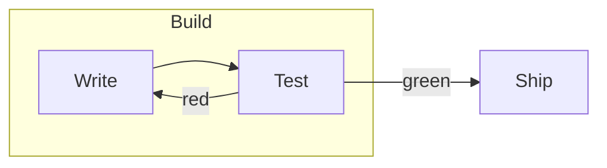
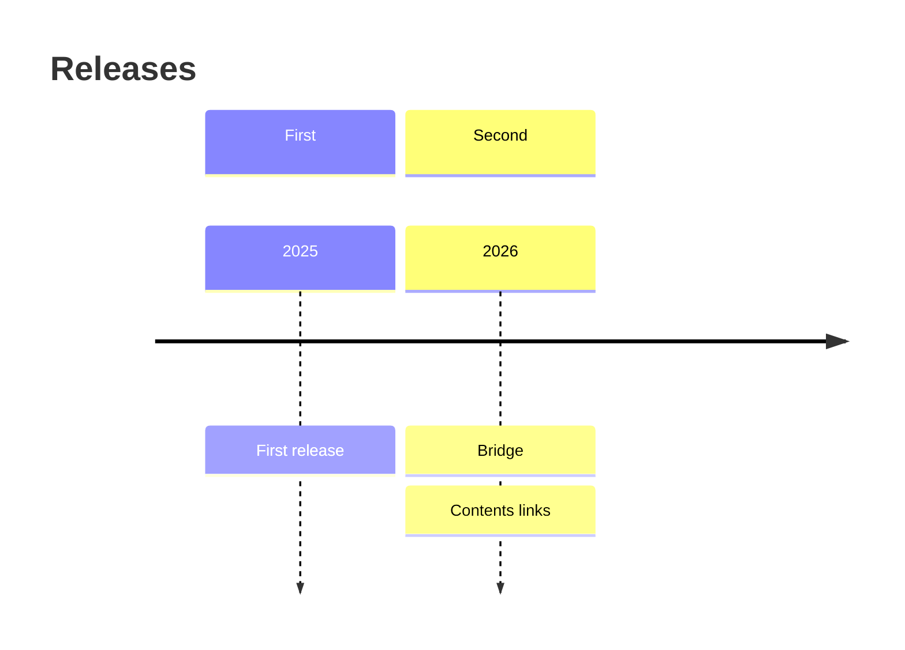

# Markdown elements

A paragraph of running text long enough to fill the measure of the article column, so its width shows the limit the bridge sets. It has an [inline link](https://docusaurus.io) and `inline code` inside the sentence, and it keeps going until it wraps over several lines of the column.

## Lists and rules

### Third level heading

- First item of an unordered list, long enough that the item wraps over more than one line of the article column and shows its limit.
- Second item with a [link in a list](https://docusaurus.io).

1. First item of an ordered list.
2. Second item of an ordered list.

---

#### Fourth level heading

##### Fifth level heading

###### Sixth level heading

## Tables

| Left | Center | Right |
| :--- | :----: | ----: |
| a    |   b    |     1 |
| c    |   d    |     2 |
| e    |   f    |     3 |

| Environment | Component | Version | Browser | Result |
| :---------- | :-------- | ------: | :-----: | :----- |
| staging     | gateway   |     1.2 | chrome  | passed |
| production  | scheduler |     3.4 | firefox | failed |

## Quotes

> Quality is never an accident; it is always the result of intelligent effort.

## Code

```ts
// Sum the values of a list.
export function sum(values: number[]): number {
  let total = 0;
  for (const value of values) total += value;
  return total;
}
```

## Admonitions

:::note
A note.
:::

:::tip
A tip.
:::

:::info
An info.
:::

:::warning
A warning.
:::

:::danger
A danger.
:::

## Diagram




